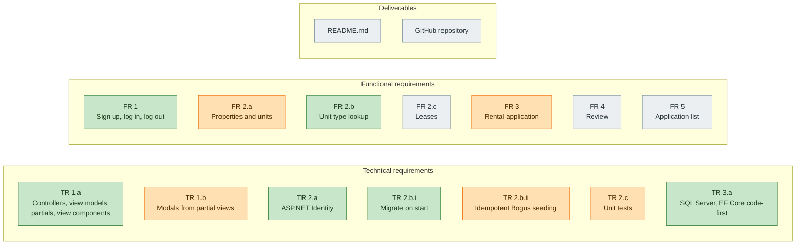
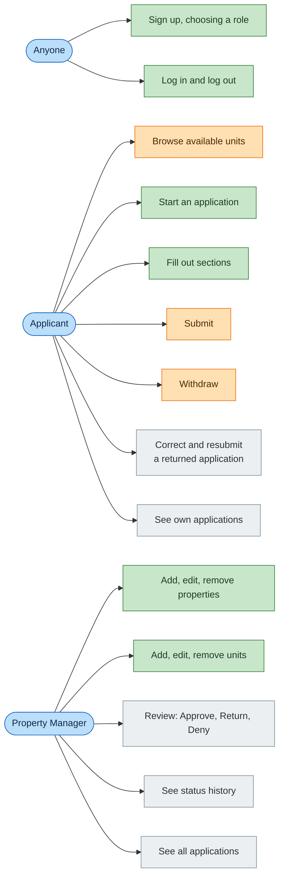
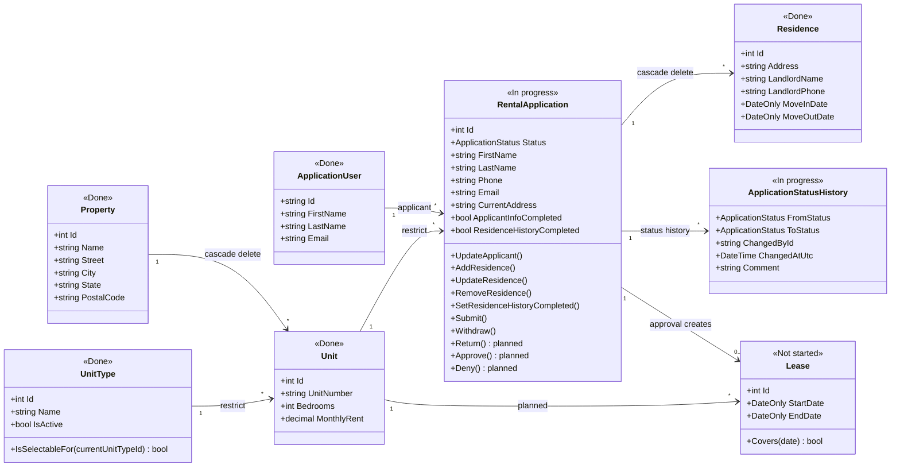
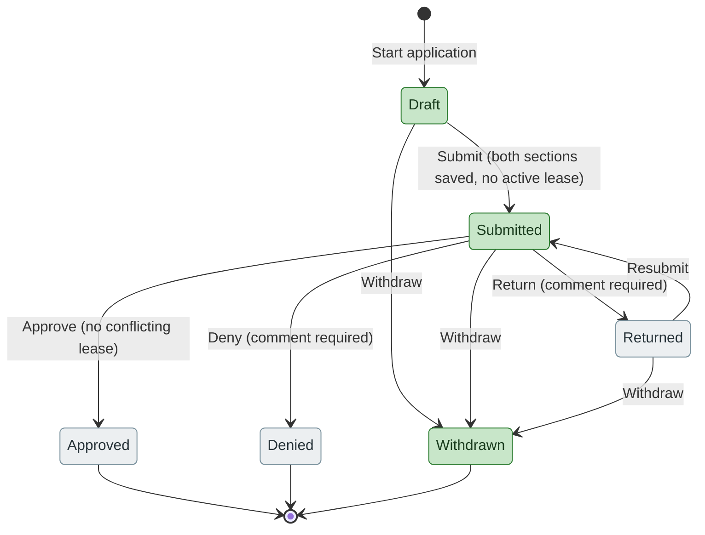
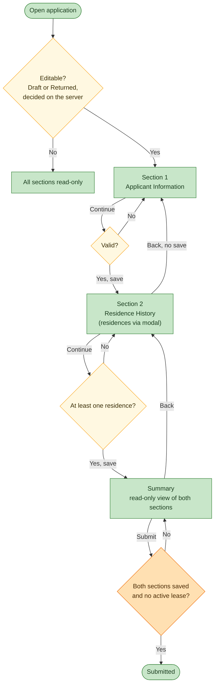
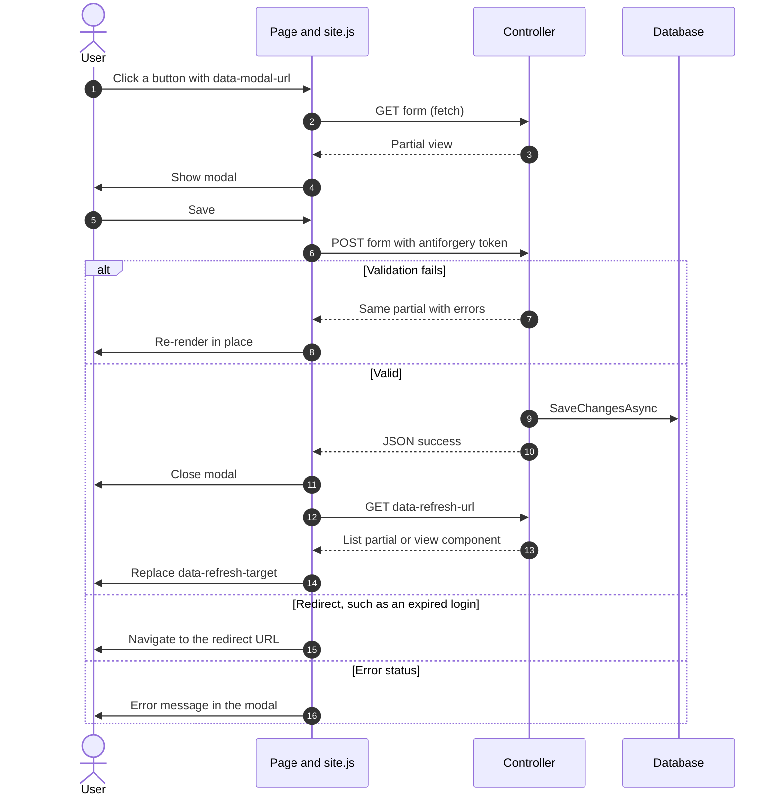
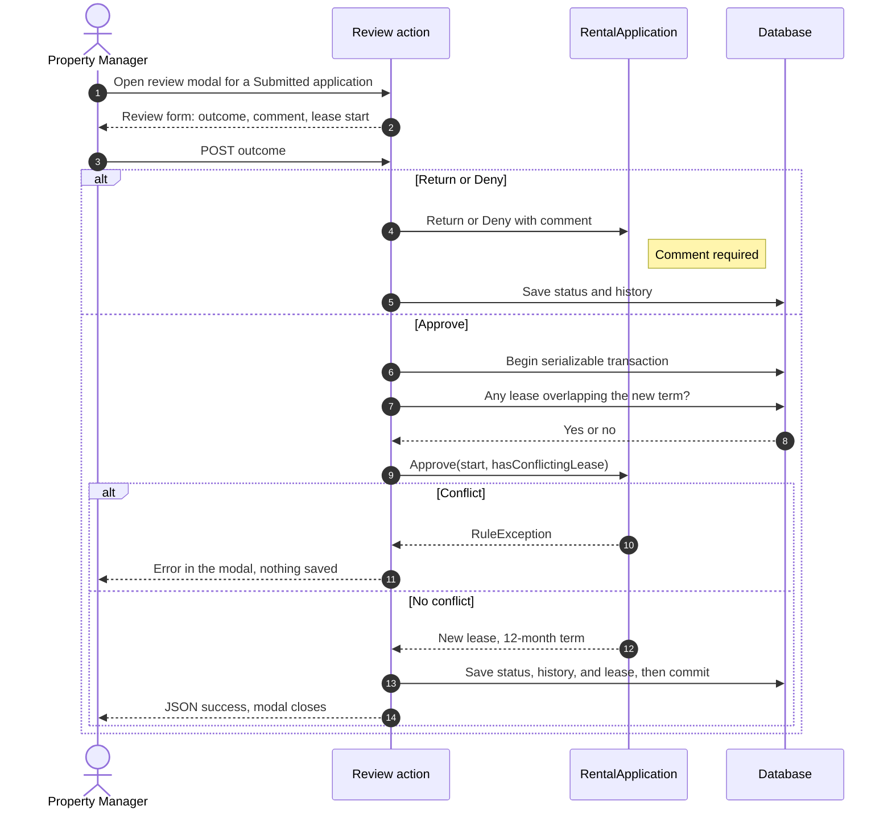

# Diagrams

Mermaid diagrams for [requirements.md](requirements.md), with the current implementation status.
Requirement IDs (for example **FR 3.b**) match [requirements-checklist.md](requirements-checklist.md).

**Status as of 2026-11-21.** Colors used in the diagrams:

| Color | Meaning |
|---|---|
| 🟩 Green | **Done**: implemented in the app |
| 🟨 Amber | **In progress**: partly implemented (for example domain model only, no UI yet) |
| ⬜ Gray | **Not started** |

Bonus items are left out; see the Bonus section of the checklist.

---

## 1. Progress by requirement area

| Area | Status | What's left |
|---|---|---|
| TR 1.b | In progress | Modals done for properties, units, and residences; the review modal remains |
| TR 2.b.ii | In progress | Roles, users, unit types, properties, units seeded; applications in every status and leases remain |
| TR 2.c | In progress | `UnitTypeTests`, `RentalApplicationTests`, `RentalApplicationExtensionsTests`, `ApplicationSectionExtensionsTests`, `RentalApplicationServiceTests` (44 passing); review, lease, and submit-with-lease tests remain |
| FR 2.a | In progress | Manager side done and applicants can start an application; Available Units lists every unit until leases exist |
| FR 2.b | Done | `Penthouse` is seeded as the inactive type, on some 3-bedroom units |
| FR 3 | In progress | 3.a–3.d done (single-page form, residence modals, Submit, server-side edit checks); the active lease check (3.e) remains |

---

## 2. Roles and permissions (Challenge)

Both roles must be enforced in the controllers **and** reflected in the UI.

"Withdraw" is amber because the rule exists in `RentalApplication` and is unit tested, but there's
no controller action or button for it yet. "Submit" is amber because it works from the Summary but
doesn't check for an active lease yet (FR 3.e). "Browse available units" is amber because the page
exists (`ListingsController`) but can't filter out leased units until `Lease` exists.
`PropertiesController` and `UnitsController` are restricted to `Roles.PropertyManager`,
`ResidencesController` to `Roles.Applicant`, and `ApplicationsController` checks ownership and
status on every save; the navbar shows Properties only to property managers, and Available Units to
anyone logged in.

---

## 3. Domain model

Each entity's status is shown as its stereotype.

Delete rules:
- Removing a **property** removes its units. Because applications use `Restrict`, the property and
  unit delete actions refuse when any application exists, with a message in the confirm modal.
- Removing an **application** isn't a feature; its residences and history would cascade with it.

---

## 4. Application status lifecycle (FR 4.b)

Green states can be reached with today's `RentalApplication`; gray states need Return, Approve, or
Deny. Approved, Denied, and Withdrawn are terminal.

| Transition | Status |
|---|---|
| Start → Draft | Done (`NewApplication`) |
| Draft → Submitted | Done, except the active lease check (FR 3.e) |
| Draft / Submitted / Returned → Withdrawn | Done (`Withdraw`) |
| Submitted → Returned, Denied, Approved | Not started |
| Returned → Submitted | Supported by `Submit` already; needs `Return` to reach Returned |

Every transition is recorded in `StatusHistory` with who, when, and an optional comment (FR 4.c).

---

## 5. Application page flow (FR 3.b)

One page, one view model, one form posting to one action. The button clicked decides what happens.
**Done** (`ApplicationsController.Details`, `Details.cshtml`), except the active lease check at
Submit (FR 3.e), shown in amber.

The controller rejects posts that aren't allowed (FR 3.d), not just hides the buttons
(`RejectEditActionResult`).

---

## 6. Modal request flow (TR 1.b) — done

How every modal in the app works: properties, units, and residences today, review later.
Implemented in `wwwroot/js/site.js` and the `Create`/`Edit`/`Delete` actions.

---

## 7. Review and approval (FR 4.a, FR 2.c, FR 3.e) — not started

The planned flow for approving an application. The serializable transaction makes sure two managers
approving at the same moment can't create two leases for the same unit.

Other open applications for the same unit are left as they are (FR 3.e). They can still be
submitted only while the unit has no active lease.
