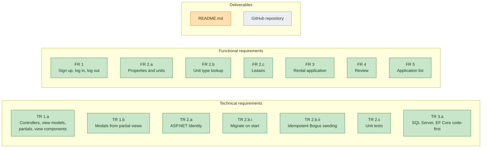
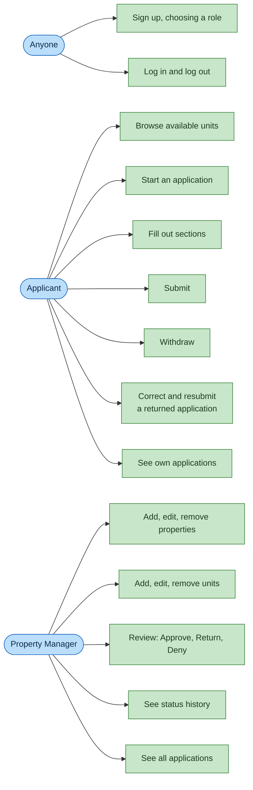
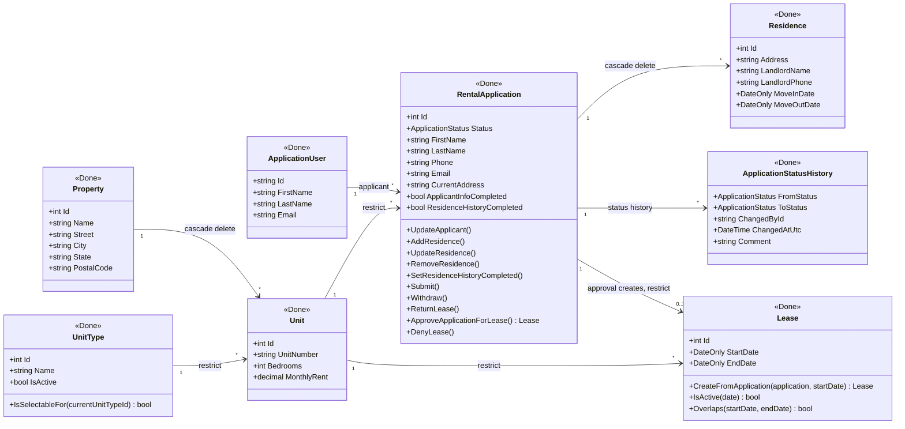
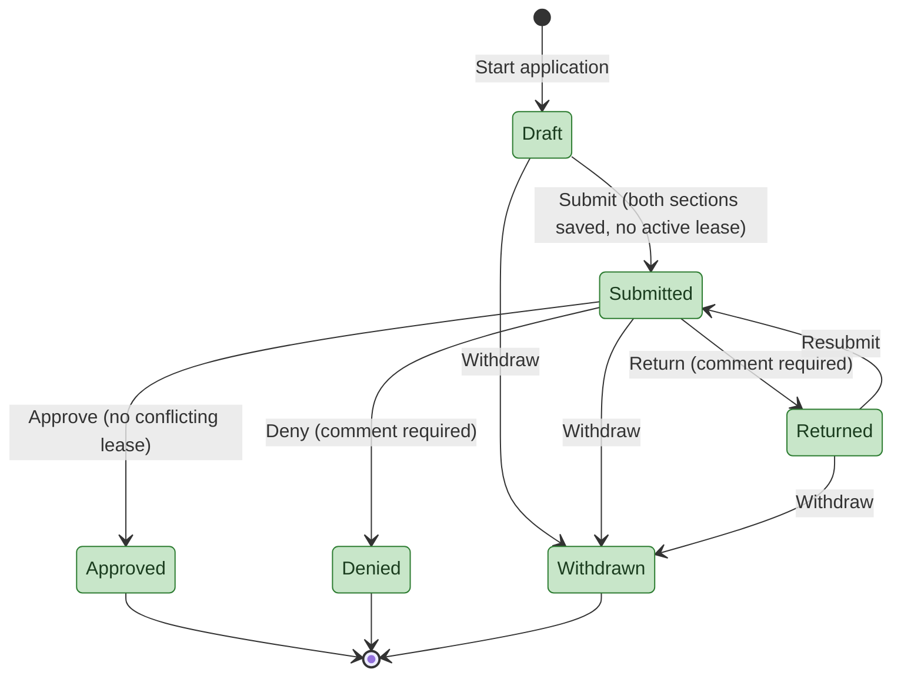
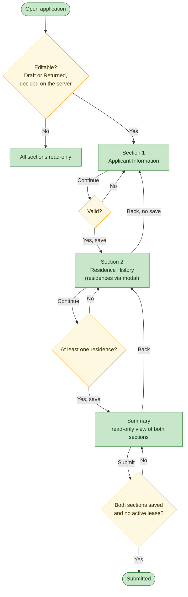
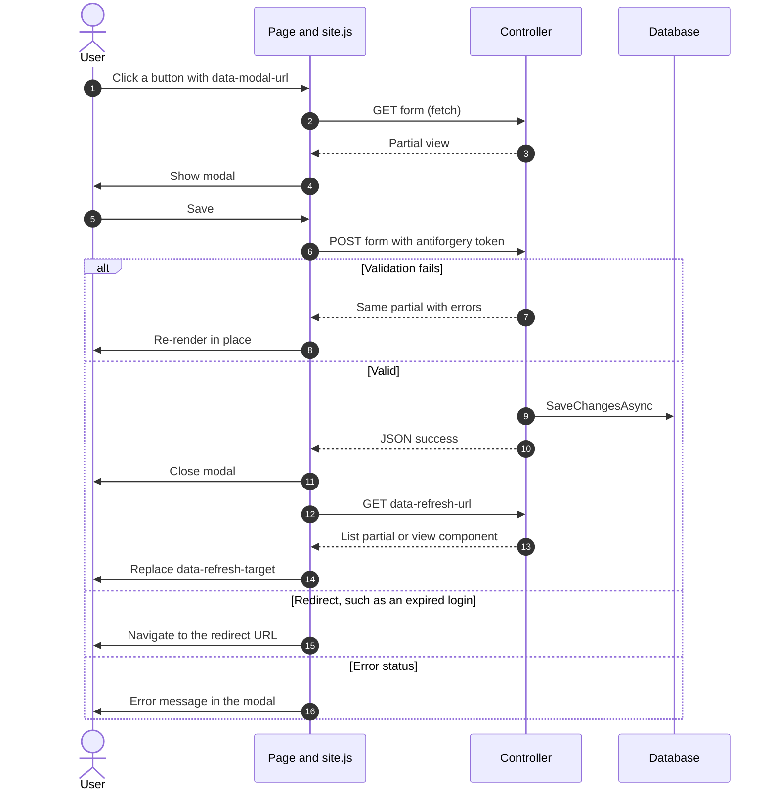
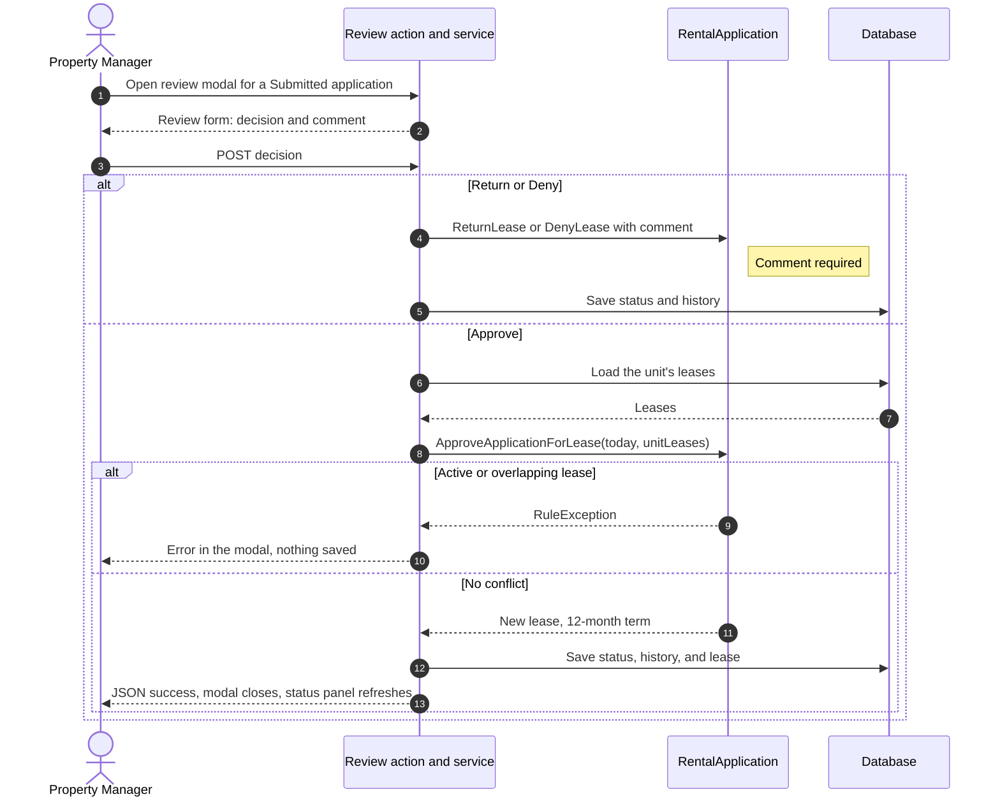

# Diagrams

Mermaid diagrams for [requirements.md](requirements.md), with the current implementation status.
Requirement IDs (for example **FR 3.b**) match [requirements-checklist.md](requirements-checklist.md).

**Status as of 2026-11-22.** Colors used in the diagrams:

| Color | Meaning |
|---|---|
| 🟩 Green | **Done**: implemented in the app |
| 🟨 Amber | **In progress**: partly implemented (for example domain model only, no UI yet) |
| ⬜ Gray | **Not started** |

Bonus items are left out; see the Bonus section of the checklist.

---

## 1. Progress by requirement area

| Area | Status | What's left |
|---|---|---|
| TR 1.b | Done | Modals for properties, units, residences, withdrawal, and review (`_ReviewForm`) |
| TR 2.b.ii | Done | Roles, users, unit types, properties, units, and applications in every status with leases for approvals (`DbSeeder.SeedApplicationsAsync`) |
| TR 2.c | Done | `UnitTypeTests`, `RentalApplicationTests`, `LeaseTests`, `RentalApplicationExtensionsTests`, `ApplicationSectionExtensionsTests`, `RentalApplicationServiceTests` (81 passing) |
| FR 2.a | Done | Available Units lists only units with no lease covering today (`ListingsController.Index`) |
| FR 2.b | Done | `Penthouse` is seeded as the inactive type, on some 3-bedroom units |
| FR 2.c | Done | Approval creates a twelve-month `Lease` starting on the approval date |
| FR 3 | Done | 3.e checks for an active lease at Submit (`RentalApplication.Submit`) and at approval |
| FR 4 | Done | Review modal (Approve, Return, Deny; comment required for Return and Deny) and status history for property managers |
| FR 5 | Done | `ApplicationsController.Index` filters by status and property in the database; applicants see only their own |
| README.md | In progress | Testing section written; setup instructions (demo logins, connection string) remain |

---

## 2. Roles and permissions (Challenge)

Both roles must be enforced in the controllers **and** reflected in the UI.

`PropertiesController` and `UnitsController` are restricted to `Roles.PropertyManager`,
`ResidencesController` to `Roles.Applicant`, and `ApplicationsController` checks ownership and
status on every save and on Withdraw (`Roles.Applicant` plus an owner check); `Review` is
`Roles.PropertyManager` only and accepts only Submitted applications. Its list action
filters to the applicant's own applications on the server. The navbar shows Properties only to
property managers, and Available Units and the application list to anyone logged in.

---

## 3. Domain model

Each entity's status is shown as its stereotype.

Delete rules:
- Removing a **property** removes its units. Because applications use `Restrict`, the property and
  unit delete actions refuse when any application exists, with a message in the confirm modal.
- Removing an **application** isn't a feature; its residences and history would cascade with it.

---

## 4. Application status lifecycle (FR 4.b)

All states can be reached with today's `RentalApplication`. Approved, Denied, and Withdrawn are
terminal.

| Transition | Status |
|---|---|
| Start → Draft | Done (`NewApplication`) |
| Draft → Submitted | Done (`Submit`; rejects an active lease, FR 3.e) |
| Draft / Submitted / Returned → Withdrawn | Done (`Withdraw`) |
| Submitted → Returned, Denied | Done (`ReturnLease`, `DenyLease`; comment required) |
| Submitted → Approved | Done (`ApproveApplicationForLease`; rejects an active or overlapping lease) |
| Returned → Submitted | Done (`Submit`; same active lease check as Draft → Submitted) |

Every transition is recorded in `StatusHistory` with who, when, and an optional comment (FR 4.c).

---

## 5. Application page flow (FR 3.b)

One page, one view model, one form posting to one action. The button clicked decides what happens.
**Done** (`ApplicationsController.Details`, `Details.cshtml`, and `RentalApplication.Submit` for the
active lease check, FR 3.e).

The controller rejects posts that aren't allowed (FR 3.d), not just hides the buttons
(`RejectEditActionResult`).

---

## 6. Modal request flow (TR 1.b) — done

How every modal in the app works: properties, units, residences, withdrawal, and review. The withdraw confirmation returns JSON with `redirectUrl`, so the page navigates to the
application list instead of refreshing a target.
Implemented in `wwwroot/js/site.js` and the `Create`/`Edit`/`Delete` actions.

---

## 7. Review and approval (FR 4.a, FR 2.c, FR 3.e) — done

`ApplicationsController.Review` and `RentalApplicationService.ReviewApplicationAsync`. The lease
starts on the approval date. There is no transaction around the lease check, so two managers
approving at the same moment could still both pass it.

Other open applications for the same unit are left as they are (FR 3.e); once the lease is active,
Submit rejects them (`Submit`).
